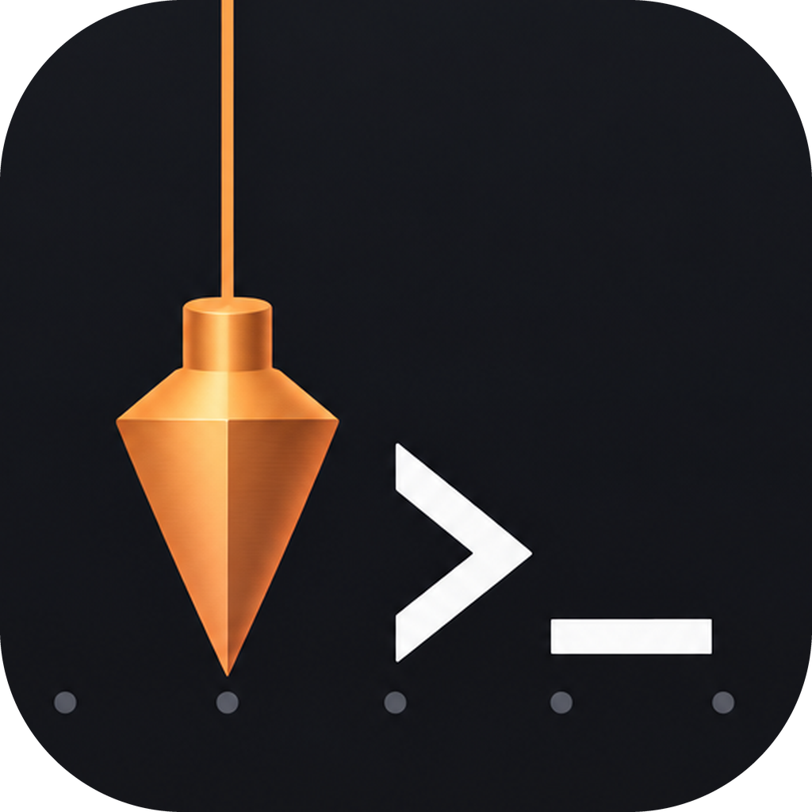

<p align="center"></p>

<h1 align="center">Plumb</h1>

<p align="center">A Windows terminal for AI coding agents that keeps their TUIs <i>plumb</i> — no more shifted, garbled lines.</p>

---

Claude Code, Copilot CLI, Codex and friends draw rich terminal UIs. On Windows those UIs
often end up misaligned: lines wrap a column early, the prompt box tears after a resize,
CJK text and emoji push borders out of place. Plumb is a small [Tauri](https://tauri.app)
app built on [xterm.js](https://xtermjs.org) that fixes the causes instead of hiding them:

- **No double reflow on resize.** xterm.js is told it sits behind ConPTY
  (`windowsPty: conpty`), so it stops reflowing the buffer itself and lets ConPTY redraw —
  the two fighting is the classic source of torn lines.
- **The same character widths as the app.** Unicode 11 widths, so emoji, CJK and the
  symbols agents draw take exactly the cells the app expects.
- **IME-safe.** The screen no longer jumps sideways while composing pinyin near the right
  edge, and punctuation typed through an IME is no longer sent twice.
- **One-click repaint** (`Ctrl+Shift+R`) for the rare case something still looks off.

## Features

- Tabs: drag to reorder, tear out into a new window, drop onto another window to merge
- Launcher for PowerShell, CMD and any agent CLI found on `PATH` (Claude Code, Copilot CLI,
  Codex, Gemini CLI, Qwen Code, opencode, Cursor Agent, Amp, Aider, ...), with a start directory picker
- Tab context menu: color, rename, duplicate, move to new window / left / right, export text, find, close others / to the right
- Find in scrollback with case and regex options
- Right-click copies the selection, or pastes when nothing is selected
- `Ctrl+wheel` / `Ctrl+=` / `Ctrl+-` / `Ctrl+0` font size
- Tabs show the shell's current directory (OSC 9;9 / OSC 7)

## Shortcuts

| Keys | Action |
|---|---|
| `Ctrl+Shift+T` | New tab |
| `Ctrl+Shift+W` | Close tab |
| `Ctrl+Shift+D` | Duplicate tab |
| `Ctrl+Shift+F` | Find |
| `Ctrl+Shift+R` | Repaint |
| `Ctrl+C` (with selection) / `Ctrl+Shift+C` | Copy |
| `Ctrl+V` | Paste |
| `Shift+Enter` | Newline inside an agent's prompt |

## Install

Download the installer from [Releases](../../releases). The app is not code-signed yet,
so Windows SmartScreen may warn on first launch ("More info" → "Run anyway").

## Build from source

Requires Node.js 22+ and a Rust toolchain ([Tauri prerequisites](https://tauri.app/start/prerequisites/)).

```sh
npm ci
npm run tauri dev      # run with hot reload
npm run tauri build    # installer in src-tauri/target/release/bundle/nsis
```

## Code signing policy

Free code signing provided by [SignPath.io](https://about.signpath.io), certificate by
[SignPath Foundation](https://signpath.org) *(application in progress; until it is
approved, releases are published unsigned)*.

- Committers and reviewers: [@lubobill1990](https://github.com/lubobill1990)
- Approvers: [@lubobill1990](https://github.com/lubobill1990)

Every release is built from this repository by GitHub Actions
([release workflow](.github/workflows/release.yml)); each signing request is approved
manually. Details: [docs/code-signing.md](docs/code-signing.md).

### Privacy

This program will not transfer any information to other networked systems unless
specifically requested by the user or the person installing or operating it. The only
network access Plumb makes on its own is the update check: a request to github.com for
this repository's latest release (and the installer download when an update is
found). It sends no data beyond a standard HTTP request. Turn it off in the ⌄ menu
("自动检查更新"); "检查更新" then checks only when you click it.

## Credits

- [xterm.js](https://xtermjs.org), [Tauri](https://tauri.app), [portable-pty](https://crates.io/crates/portable-pty)
- Agent icons from [Simple Icons](https://simpleicons.org) (CC0). The logos are trademarks of
  their respective owners and are used only to identify the CLI being launched.
- App icon generated with an image model and finished by hand (`design/`).

## License

[MIT](LICENSE)

## Updates

Plumb updates itself from this repo's GitHub Releases, with a dedicated updater modelled on
[Longarm](https://github.com/lubobill1990/longarm)'s update service:

- **Check**: at start and every 6 hours, `latest.json` of the newest release. Only a
  strictly newer version is offered; never a downgrade.
- **Verify**: the installer is downloaded in the background and must carry a minisign
  signature from the release key built into the app, whose trusted comment names exactly
  `Plumb_<version>_x64-setup.exe` (an older release's signature can't be replayed).
- **Install when you say so**: the title bar shows "Plumb x.y.z 已就绪 · 重启更新". A
  restart ends every tab's process, so Plumb never restarts on its own and asks first
  when tabs are open.
- **Dedicated updater**: `plumb.exe --updater`, run from a copy in
  `%LOCALAPPDATA%\com.lubobill1990.plumb\updates`, waits for Plumb to exit, verifies the
  installer again, backs up the install, installs silently, checks the installed version,
  starts it and waits up to 60 s for it to report healthy.
- **Rollback**: if any step after the backup fails (installer error, wrong version, the
  new version crashes or never reports healthy) the backup is restored and the previous
  version started. The launcher (⌄ menu) also offers "回滚到 <previous version>".
- **Monitoring**: every phase is written to `updates\state.json` and `updates\update.log`;
  the next start of Plumb shows the outcome (updated / rolled back / failed) and the
  launcher opens the log.

## Releasing

1. Bump `version` in `src-tauri/tauri.conf.json`, `src-tauri/Cargo.toml` and `package.json`.
2. Merge to `main`, then push a tag: `git tag v0.2.0 && git push origin v0.2.0`.
3. The Release workflow builds and signs the installer and publishes it with `latest.json`;
   installed copies offer the update within 6 hours.

Signing needs the repo secrets `TAURI_SIGNING_PRIVATE_KEY` and
`TAURI_SIGNING_PRIVATE_KEY_PASSWORD` (the updater key; its public half is
`src-tauri/updater.pub`). The updater E2E test is in `scripts/updater-e2e`.
